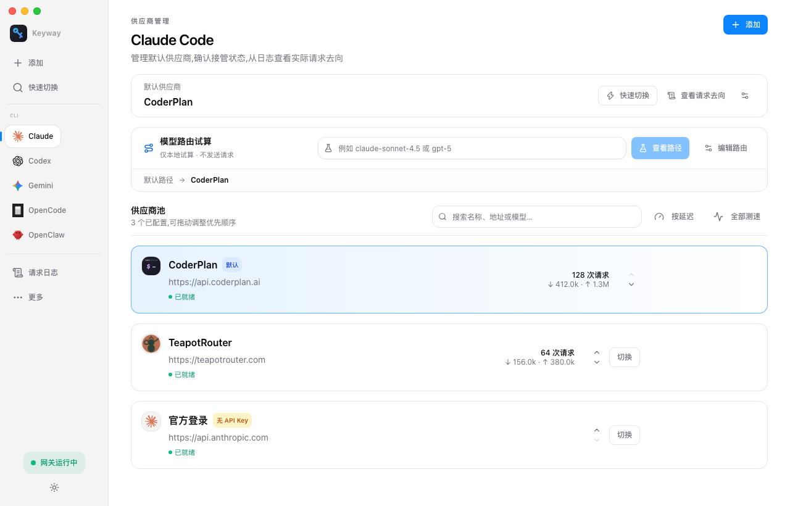
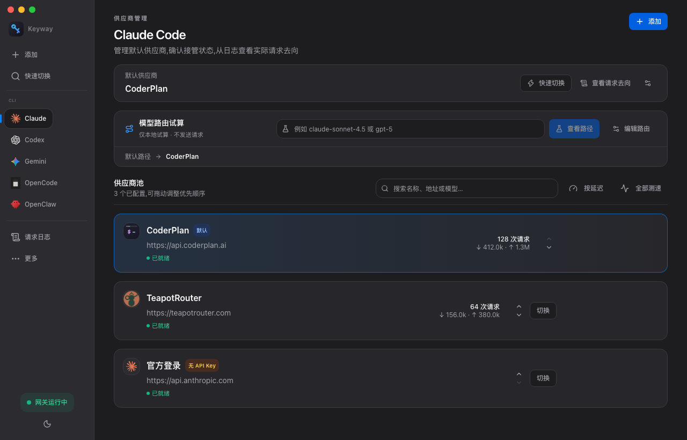

<div align="center">


# Keyway

**One key · one way — AI コーディング CLI のためのローカルゲートウェイ**

[](#インストール)
[](https://tauri.app)
[](LICENSE)
[](https://github.com/anmutu/keyway/releases/latest)
[](https://github.com/anmutu/keyway/stargazers)

[English](README.md) · [简体中文](README.zh-CN.md) · **[日本語](README.ja.md)**

AI コーディング CLI のプロバイダー切替・モデルルーティング・フェイルオーバーを、
**セッションを再起動せずに**実現。リクエストログで「毎回のリクエストがどこに
向かったか」を正確に確認できます。API キーは端末内の暗号化データベースに保存。

[公式サイト](https://keyway.one/) · [ガイド](https://keyway.one/en/guide.html) · [ブログ](https://keyway.one/en/blog/) · [ダウンロード](https://keyway.one/en/download.html)

| ライト | ダーク |
| :---: | :---: |
|  |  |

</div>

---

## 解決する課題

複数の AI コーディング CLI を使い分けると、それぞれが独自の設定ファイルを持ち、
プロバイダーの切替のたびに設定を編集し、環境変数を export し、ターミナルを
再起動することになります。リクエストが失敗したとき、原因が CLI・プロバイダー・
ネットワークのどれかを特定する手段もありません。

Keyway は CLI とプロバイダーの間に立つ**ローカルプロキシ**です。各 CLI の
テイクオーバーは一度だけ。その後は、プロバイダー切替がワンキーストローク、
ルーティングはルール駆動、障害時はバックアップへ自動フェイルオーバー、
そして全リクエストが「プロバイダー / モデル / ステータスコード」付きの
ログを残します。

## 主な機能

- **🧭 リクエストの実際の宛先を可視化** — 既定プロバイダーとテイクオーバー状態を分けて表示。リクエストログには実際のプロバイダー・モデル・ステータスコード・適用されたルーティングルールを記録。
- **⚡ 再起動不要の切替** — ローカルプロキシ(`127.0.0.1:9527`)経由のセッションは、次のリクエストから新しいプロバイダーを利用。`⌘⇧K` でどこからでもクイック切替パネルを開けます。
- **🔀 モデルルーティング** — 特定のモデルを特定のプロバイダーへ(「含む / 前缀一致」で判定)。超長コンテキストを指定プロバイダーへ自動送出、ディープシンキングと軽量タスクを別チャネルへ分流。
- **🛟 自動フェイルオーバー** — CLI グループごとに候補チェーンを設定。再試行可能な接続エラー・429・5xx は次のプロバイダーへ。フェイルバック時は `x-keyway-fallback` ヘッダー付き。
- **🔐 端末内の暗号化ストレージ** — API キーは SQLCipher データベースに保存し、マスターキーは OS のキーチェーンが管理。エクスポートされる設定にキーは含まれません。
- **📊 使用量とログ** — トークン使用量は上流レスポンスから抽出(集計用の追加リクエストなし)。使用量ページは CLI / プロバイダー別に集計、ログは直近 100 件を保持。
- **🧩 MCP と Skills の一元管理** — MCP サーバーの定義は一度だけ。Claude Code と Codex の設定へ自動書き込み。Skills はローカル保管してワンクリック同期。手動設定は決して上書きしません。
- **🧰 プロファイルとポータブルな設定共有** — プロバイダー構成をプロファイルとして保存(仕事 / 個人 / 検証)。キーを含まない JSON バックアップ、名前ベースマージのインポートでチーム展開も一歩。

## 対応 CLI

Claude Code · Codex · Gemini CLI · OpenCode · OpenClaw · Crush · Droid · Qwen Code

OpenAI / Anthropic / Gemini 互換のエンドポイントなら任意のカスタム
プロバイダーとして追加できます。プロバイダーごとのトグルでプロトコル差を
吸収(例:Chat のみ対応プロバイダーのために Codex の `/v1/responses` を
`/v1/chat/completions` へブリッジ)。

## インストール

| 方法 | コマンド / リンク |
|---|---|
| **インストーラー** | [最新リリース](https://github.com/anmutu/keyway/releases/latest)からダウンロード — macOS(Apple Silicon / Intel)、Windows、Linux |
| **ワンライナー**(macOS) | `curl -fsSL https://keyway.one/install.sh \| sh` |
| **Homebrew**(macOS) | `brew install --cask --no-quarantine keyway` *(tap: `anmutu/homebrew-tap`)* |

> **macOS 初回起動時:** インストーラーは公証(notarization)されていません
> (個人 OSS プロジェクトのため)。Gatekeeper が警告したら、Finder で
> `Keyway.app` を**右クリック → 開く → 「開く」**を選んでください
> (初回のみ)。`curl` と Homebrew の方法ではこの手順は不要です。
> **Windows:** SmartScreen の警告は「詳細情報 → 実行」を選択。

## クイックスタート

1. **プロバイダーを追加** — プリセットを選ぶか、Base URL + API キー + モデル名を入力。接続テストもワンクリック。
2. **CLI をテイクオーバー** — ワンクリックで元の設定を暗号化バックアップし、`127.0.0.1:9527` へ向けて設定。
3. **検証** — CLI からリクエストを送り、ログを確認:プロバイダー・モデル・ステータス。`http://127.0.0.1:9527/healthz` が CLI グループごとの現行プロバイダーを返します。

**いつでも復元** — 「復元」ボタンで CLI の元設定をそのまま戻せます。Codex の
初回テイクオーバー後は新しいセッションが 1 回必要です。以降、プロキシ経由の
セッションは再起動不要です。

## 利用上の境界(一度だけ読んでください)

- 切替は**後続**のリクエストに適用されます。送信済みリクエストは移行されません。
- ローカル保存 ≠ ローカル推論。リクエスト内容と認証情報は選択したプロバイダーへ送信されます。
- テイクオーバー中は Keyway を起動したままにしてください(ウィンドウを閉じてもトレイ常駐可)。完全終了するとプロキシも停止します。

## ドキュメント

| ドキュメント | 内容 |
|---|---|
| [サイトのガイド](https://keyway.one/en/guide.html)(英語) | セットアップ・テイクオーバー・検証・トラブルシューティングの完全版 |
| [プロダクトノート](docs/guide/README.md) | 解決する課題 / 主要概念 / 5 分セットアップ / FAQ |
| [Claude Code](docs/guide/claude-code.md) | テイクオーバー、切替、公式サブスクリプションとの共存 |
| [Codex](docs/guide/codex.md) | 完全なトラブルシューティング |
| [Gemini CLI](docs/guide/gemini.md) | Gemini 形式プロバイダーの接続 |
| [GLM](docs/guide/providers/glm.md) / [Kimi](docs/guide/providers/kimi.md) | Anthropic 互換エンドポイントの接続例 |

ツール不要の手動設定チュートリアルは [keyway.one/blog](https://keyway.one/en/blog/) へ。

## キーボードショートカット

| ショートカット | 動作 |
|---|---|
| `⌘⇧K` / `Ctrl+Shift+K` | クイック切替パネル(↑↓ 選択、Enter 切替、Esc 閉じる) |
| `⌘N` | 新規プロバイダー |
| `⌘1..5` | CLI グループへ移動 |
| `⌘⇧M` / `⌘⇧S` | MCP / Skills 管理 |

## ロードマップ

- **実装済み** — テイクオーバーと復元、設定インポート、ルーティングとフェイルオーバー、ログと使用量、MCP/Skills 管理。
- **進行中** — 実 CLI とパッケージビルド間の互換性回帰テスト、フロントエンドのテストカバレッジ。
- **検討中** — プロジェクト単位のコスト帰属、クラウド同期、チーム設定共有(交付の約束ではありません)。

詳細は [docs/design.md](docs/design.md)。

## 開発

```bash
pnpm install
pnpm tauri dev     # 開発実行(初回にキーチェーンアクセスを要求)
pnpm tauri build   # プロダクションビルド
```

要件:Node 18+ / pnpm / Rust 1.85+ / Xcode Command Line Tools(macOS)。
貢献ガイドは [CONTRIBUTING.md](CONTRIBUTING.md) を参照。

## コントリビューター

Keyway の改善に協力してくださるすべての方に感謝します!

<a href="https://github.com/anmutu/keyway/graphs/contributors">
  
</a>

貢献を歓迎します — [CONTRIBUTING.md](CONTRIBUTING.md) を参照。

## Star History

[](https://star-history.com/#anmutu/keyway&Date)

## ライセンス

[MIT](LICENSE) — 永久に無料。Keyway はローカルツールです。テレメトリなし、
このリポジトリが製品のすべてです。
