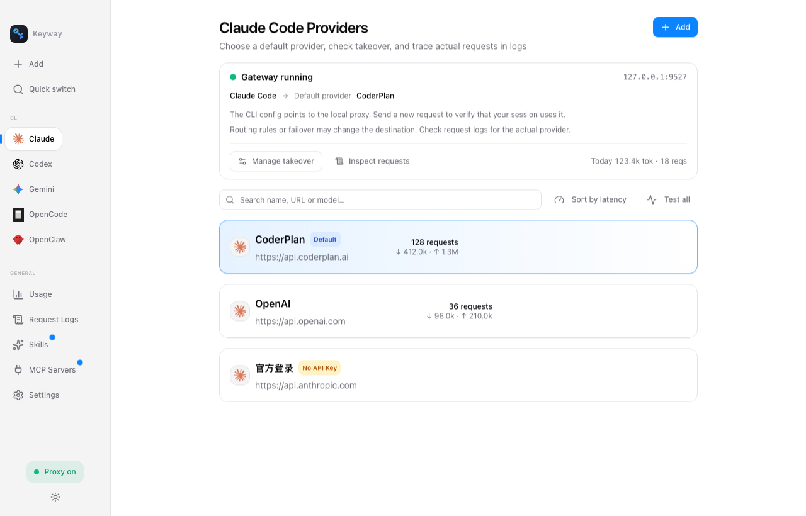
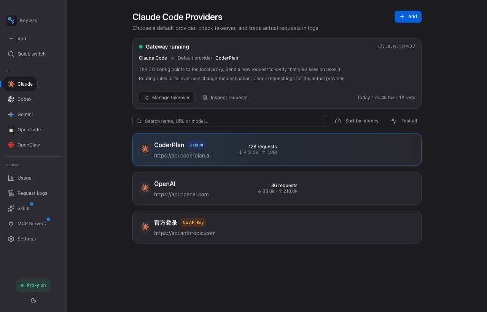

<div align="center">

# Keyway

### AI CLI 的本地网关

[](#)
[](https://tauri.app)
[](LICENSE)

**让 AI CLI 的每一次请求,都有清楚、可控的去向。**

为 **Claude Code · Codex · Gemini CLI · OpenCode · OpenClaw** 管理供应商、路由与故障转移,从请求日志查看实际去向。API Key 存储于本机加密数据库。

[特性](#-核心特性) · [快速开始](#-快速开始)

|                  浅色                  |                  深色                  |
| :-----------------------------------: | :-----------------------------------: |
|  |  |

</div>

---

## ✨ 核心特性

- **🧭 看清请求去向** — 分开显示默认供应商与接管状态;通过日志核对实际供应商、模型、状态码及路由规则
- **⚡ 通过代理切换** — 已接入本地代理(`127.0.0.1:9527`)的会话,切换默认供应商无需重启;路由规则可能覆盖默认选择
- **🛟 故障转移与排查** — 可配置备用候选链,对可重试失败尝试备用供应商;日志提供错误信息,不承诺流式响应中途无缝恢复
- **🔐 本机加密存储** — API Key 存 SQLCipher 加密数据库,数据库主密钥由系统钥匙串保管;导出的供应商配置不含 API Key
- **📊 转发即计量** — 从上游响应提取 token 用量并记录请求,不为计量额外发起模型请求;统计完整性取决于上游返回的 usage
- **🌗 浅色 / 深色 / 跟随系统** 三态主题,`⌘N` 新建、`⌘1..5` 快速切换应用

> **使用边界:** 首次接管 Codex 后需新开一次会话。接管期间应保持 Keyway 运行;关闭窗口可驻留托盘,完全退出会停止代理。需要直连时请先还原 CLI 配置。切换影响后续请求,不会迁移已发出的请求。本地存储不代表离线推理:请求内容与认证信息仍会发送给所选上游。

## 📦 安装

从 [Releases](https://github.com/anmutu/keyway/releases/latest) 下载对应平台安装包。

> **macOS 首次打开**:安装包未做 Apple 公证(个人开源项目),双击若提示「无法验证开发者」——在 Finder 里**右键点 Keyway.app → 打开 → 再点「打开」**即可,仅首次需要。
> **Windows**:SmartScreen 提示时选「仍要运行」。

## 🚀 快速开始

```bash
pnpm install
pnpm tauri dev     # 开发(首次会请求钥匙串授权)
pnpm tauri build   # 构建
```

环境要求:Node 18+ / pnpm / Rust 1.85+ / Xcode CLT(macOS)。

## 📖 使用文档

| 文档 | 内容 |
|---|---|
| [产品说明](docs/guide/README.md) | 解决什么问题 / 核心特点 / 5 分钟上手 / FAQ |
| [Claude Code 指南](docs/guide/claude-code.md) | 接管、切换、官方订阅共存 |
| [Codex 指南](docs/guide/codex.md) | 完整故障排查 |
| [Gemini CLI 指南](docs/guide/gemini.md) | Gemini 格式供应商接入 |
| [GLM 接入](docs/guide/providers/glm.md) / [Kimi 接入](docs/guide/providers/kimi.md) / [CoderPlan 接入](docs/guide/providers/coderplan.md) | Anthropic 兼容端点接法 |

## 🗺️ 路线图

- **现有实现**:接管与还原、配置导入、路由与故障转移、日志与用量、MCP/Skills 管理。
- **待完善**:真实 CLI 与打包应用的兼容性回归、前端自动化测试覆盖。
- **未来探索**:项目/会话成本归因、云同步、团队配置共享(不代表已实现或交付承诺)。

详见 [docs/design.md](docs/design.md)。

## License

MIT
