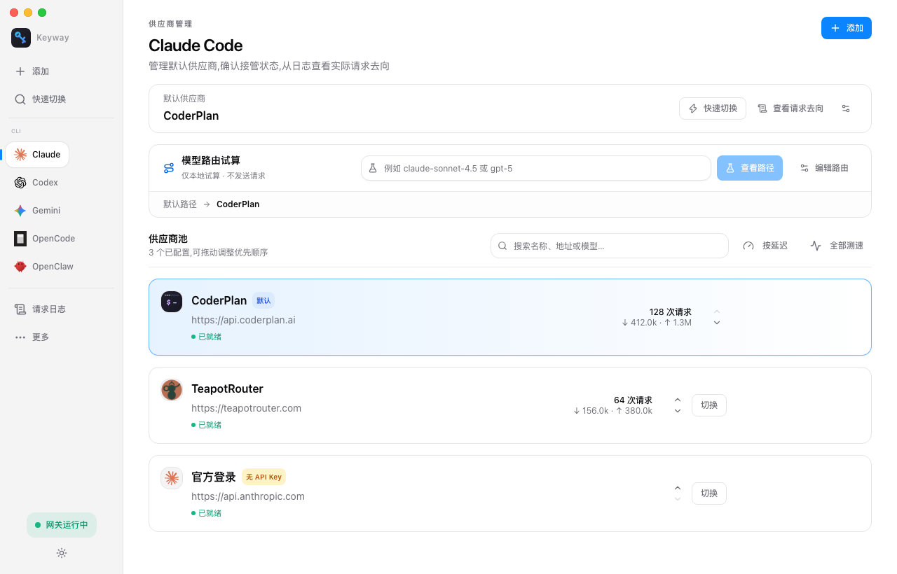
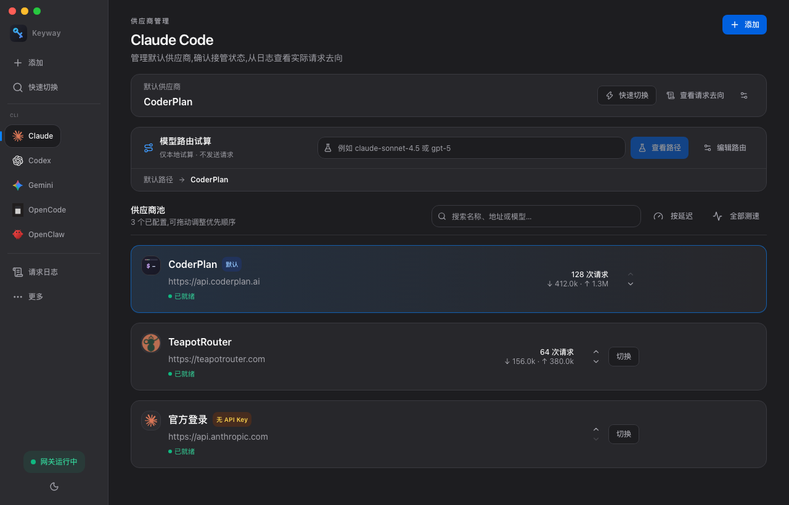

<div align="center">


# Keyway

**One key · one way — the local gateway for AI coding CLIs**

[](#installation)
[](https://tauri.app)
[](LICENSE)
[](https://github.com/anmutu/keyway/releases/latest)
[](https://github.com/anmutu/keyway/stargazers)

**[English](README.md)** · [简体中文](README.zh-CN.md) · [日本語](README.ja.md)

Switch providers, route models and survive failures for your AI coding CLIs —
**without restarting sessions**, and with request logs that show exactly where
every request went. API keys live in an encrypted on-device database.

[Website](https://keyway.one/) · [Guide](https://keyway.one/en/guide.html) · [Blog](https://keyway.one/en/blog/) · [Download](https://keyway.one/en/download.html)

| Light | Dark |
| :---: | :---: |
|  |  |

</div>

---

## Why

You use several AI coding CLIs. Each has its own config file, each points at one
provider, and every experiment means editing configs, exporting env vars and
restarting terminals. When a request fails you have no idea whether the CLI,
the provider or the network is to blame.

Keyway sits between your CLIs and your providers as a **local proxy**. Take over
a CLI once; after that, switching providers is one keystroke, routing is
rule-driven, failures fall over to backups, and every request leaves a log line
with provider, model and status.

## Features

- **🧭 See where requests actually go** — default provider and takeover status are shown separately; request logs record the real provider, model, status code and matched routing rule for every request.
- **⚡ Switch without restarting** — sessions already routed through the local proxy (`127.0.0.1:9527`) pick up provider changes on the next request. `⌘⇧K` opens the quick-switch panel from anywhere.
- **🔀 Model routing** — keep specific models on specific providers (match by *contains* or *starts with*), automatically send long contexts to a designated provider, and split deep-think vs. background-lite traffic into different channels.
- **🛟 Automatic failover** — configure a candidate chain per CLI group; retryable connection errors, 429 and 5xx move on to the next provider. Fallback responses carry an `x-keyway-fallback` header.
- **🔐 Encrypted on-device storage** — API keys are stored in a SQLCipher database whose master key lives in the OS keychain. Exported provider configs never contain keys.
- **📊 Usage & logs** — token usage is extracted from upstream responses (no extra model calls); the Usage page aggregates by CLI and provider, Logs keeps the last 100 requests.
- **🧩 Unified MCP & Skills management** — define MCP servers once and have them written into Claude Code and Codex configs; keep Skills in a local vault and sync them in one click. Manually configured entries are never touched.
- **🧰 Profiles & portable config** — save provider sets as profiles (work / personal / testing), export a JSON backup (keys excluded) via the system save dialog, and share setups: imports merge by name.

## Supported CLIs

Claude Code · Codex · Gemini CLI · OpenCode · OpenClaw · Crush · Droid · Qwen Code

Any OpenAI-, Anthropic- or Gemini-compatible endpoint can be added as a custom
provider. Per-provider toggles adapt protocol differences (e.g. bridging Codex
`/v1/responses` requests to `/v1/chat/completions` for chat-only providers).

## Installation

| Method | Command / link |
|---|---|
| **Installer** | Download from the [latest release](https://github.com/anmutu/keyway/releases/latest) — macOS (Apple Silicon & Intel), Windows, Linux |
| **One-liner** (macOS) | `curl -fsSL https://keyway.one/install.sh \| sh` |
| **Homebrew** (macOS) | `brew install --cask --no-quarantine keyway` *(tap: `anmutu/homebrew-tap`)* |

> **macOS first launch:** installers are not notarized (personal open-source
> project). If Gatekeeper complains, right-click `Keyway.app` → **Open** →
> **Open** — once is enough. The `curl` and Homebrew methods skip this.
> **Windows:** choose *More info → Run anyway* on the SmartScreen prompt.

## Quick start

1. **Add a provider** — pick a preset or enter a Base URL + API key + model name. A reachability test is one click.
2. **Take over a CLI** — one click backs up the CLI's original config (encrypted, local) and points it at `127.0.0.1:9527`.
3. **Verify** — send a request from the CLI and check the log line: provider, model, status. `http://127.0.0.1:9527/healthz` reports the current provider per CLI group.

**Restore anytime** — the Restore button puts the CLI's original config back. First Codex takeover needs one fresh session; sessions already on the proxy never need restarting again.

## Boundaries (read this once)

- Switching affects **subsequent** requests; in-flight requests are not migrated.
- Local storage is not local inference: request content and authentication still go to the provider you select.
- Keep Keyway running while CLIs are taken over (closing the window can keep it in the tray); fully quitting stops the proxy.

## Documentation

| Doc | Contents |
|---|---|
| [Website guide](https://keyway.one/en/guide.html) | Full walkthrough: setup, takeover, verification, troubleshooting |
| [Product notes](docs/guide/README.md) | What problem it solves / core concepts / 5-minute setup / FAQ |
| [Claude Code](docs/guide/claude-code.md) | Takeover, switching, coexisting with official subscriptions |
| [Codex](docs/guide/codex.md) | Full troubleshooting |
| [Gemini CLI](docs/guide/gemini.md) | Connecting Gemini-format providers |
| [GLM](docs/guide/providers/glm.md) / [Kimi](docs/guide/providers/kimi.md) | Anthropic-compatible endpoints |

Blog posts with hands-on, tool-free configurations live at
[keyway.one/blog](https://keyway.one/blog/).

## Keyboard shortcuts

| Shortcut | Action |
|---|---|
| `⌘⇧K` / `Ctrl+Shift+K` | Quick-switch panel (↑↓ select, Enter switch, Esc dismiss) |
| `⌘N` | New provider |
| `⌘1..5` | Jump to a CLI group |
| `⌘⇧M` / `⌘⇧S` | MCP / Skills management |

## Roadmap

- **Done** — takeover & restore, config import, routing & failover, logs & usage, MCP/Skills management.
- **In progress** — compatibility regression across real CLIs and packaged builds, front-end test coverage.
- **Exploring** — per-project cost attribution, cloud sync, team config sharing (*not* a delivery promise).

Details in [docs/design.md](docs/design.md).

## Development

```bash
pnpm install
pnpm tauri dev     # development (asks for keychain access on first run)
pnpm tauri build   # production build
```

Requires Node 18+, pnpm, Rust 1.85+ and Xcode Command Line Tools (macOS).
See [CONTRIBUTING.md](CONTRIBUTING.md) for guidelines.

## Contributors

Thanks to everyone who improves Keyway!

<a href="https://github.com/anmutu/keyway/graphs/contributors">
  
</a>

Contributions welcome — see [CONTRIBUTING.md](CONTRIBUTING.md).

## Star History

[](https://star-history.com/#anmutu/keyway&Date)

## License

[MIT](LICENSE) — free forever. Keyway is a local tool: it ships no telemetry,
and this repository is the entire product.
