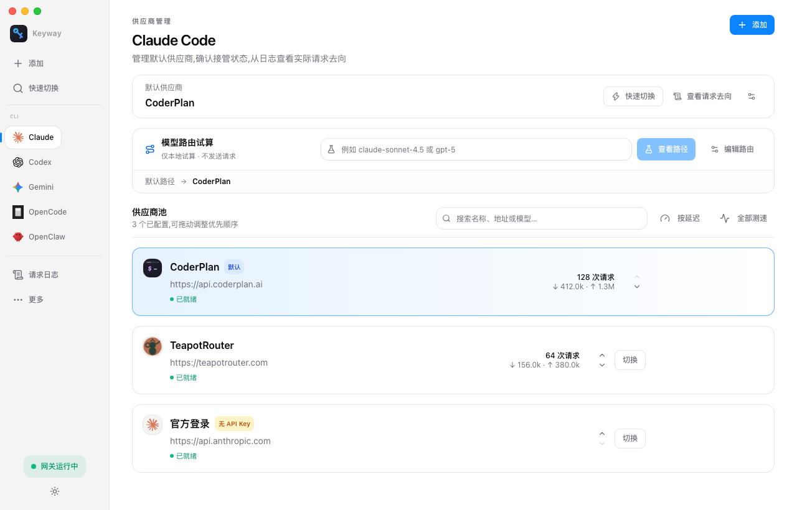
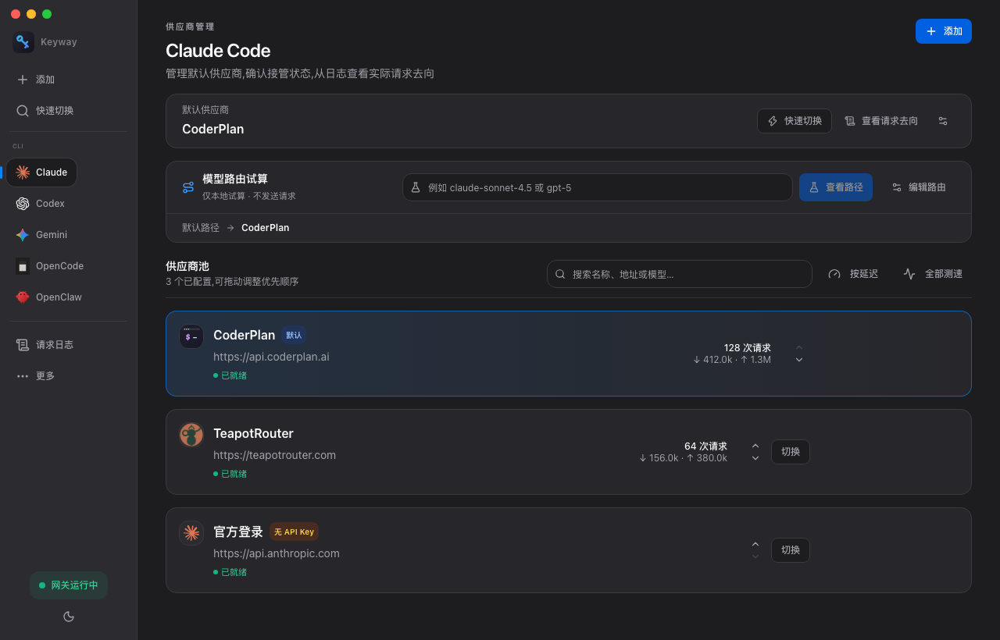

<div align="center">


# Keyway

**One key · one way — AI CLI 的本地网关**

[](#安装)
[](https://tauri.app)
[](LICENSE)
[](https://github.com/anmutu/keyway/releases/latest)
[](https://github.com/anmutu/keyway/stargazers)

[English](README.md) · **[简体中文](README.zh-CN.md)** · [日本語](README.ja.md)

为 AI 编程 CLI 管理供应商、模型路由与故障转移——**切换不重启会话**,
请求日志看清每一次请求的实际去向。API Key 存储于本机加密数据库。

[官网](https://keyway.one/) · [使用指南](https://keyway.one/guide.html) · [博客](https://keyway.one/blog/) · [下载](https://keyway.one/download.html)

| 浅色 | 深色 |
| :---: | :---: |
|  |  |

</div>

---

## 解决什么问题

你在用多个 AI 编程 CLI:每个都有自己的配置文件、只指向一个供应商,
每次换供应商都要改配置、导出环境变量、重启终端;请求失败了,
分不清是 CLI、供应商还是网络的锅。

Keyway 作为**本地代理**坐在 CLI 和供应商之间。每个 CLI 只需接管一次,
之后:切换供应商是一次快捷键的事,路由按规则走,失败自动切备用,
每个请求都留下「供应商 / 模型 / 状态码」的日志。

## 核心特性

- **🧭 看清请求去向** — 默认供应商与接管状态分开显示;请求日志记录每个请求的实际供应商、模型、状态码与命中的路由规则。
- **⚡ 切换不重启** — 已接入本地代理(`127.0.0.1:9527`)的会话,下一个请求即生效。`⌘⇧K` 随时唤出快速切换面板。
- **🔀 模型路由** — 指定模型走指定供应商(按「包含」或「前缀」匹配);超长上下文自动走低价通道;深度思考与轻量任务分流到不同供应商。
- **🛟 自动故障转移** — 为每个 CLI 组配置候选链;可重试的连接错误、429、5xx 自动尝试下一家。回退响应带 `x-keyway-fallback` 标记。
- **🔐 本机加密存储** — API Key 存 SQLCipher 加密数据库,主密钥由系统钥匙串保管;导出的供应商配置永不包含 Key。
- **📊 用量与日志** — token 用量从上游响应提取(不为计量额外发起请求);用量页按 CLI / 供应商汇总,日志保留最近 100 条。
- **🧩 MCP 与 Skills 统一管理** — MCP 服务器定义一次,自动写入 Claude Code 与 Codex 配置;Skills 存本地库一键同步。手动配置的条目不会被触碰。
- **🧰 配置档案与便携共享** — 供应商组合存为档案(工作 / 个人 / 测试);JSON 备份不含 Key;导入按名称合并,团队共享一步到位。

## 支持的 CLI

Claude Code · Codex · Gemini CLI · OpenCode · OpenClaw · Crush · Droid · Qwen Code

任何 OpenAI / Anthropic / Gemini 兼容端点都可以作为自定义供应商接入;
按供应商开关适配协议差异(如为仅支持 Chat 的供应商把 Codex 的
`/v1/responses` 桥接为 `/v1/chat/completions`)。

## 安装

| 方式 | 命令 / 链接 |
|---|---|
| **安装包** | 从[最新 Release](https://github.com/anmutu/keyway/releases/latest) 下载 — macOS(Apple Silicon 与 Intel)、Windows、Linux |
| **一键脚本**(macOS) | `curl -fsSL https://keyway.one/install.sh \| sh` |
| **Homebrew**(macOS) | `brew install --cask --no-quarantine keyway` *(tap: `anmutu/homebrew-tap`)* |

> **macOS 首次打开**:安装包未做 Apple 公证(个人开源项目)。若 Gatekeeper
> 提示「无法验证开发者」——在 Finder 里**右键 Keyway.app → 打开 → 再点「打开」**,
> 仅首次需要。`curl` 与 Homebrew 方式无此提示。
> **Windows**:SmartScreen 提示时选「更多信息 → 仍要运行」。

## 快速开始

1. **添加供应商** — 选预设,或填 Base URL + API Key + 模型名;一键测试连通性。
2. **接管 CLI** — 一键把 CLI 的原始配置加密备份到本机,并指向 `127.0.0.1:9527`。
3. **验证** — 从 CLI 发一条请求,看日志:供应商、模型、状态码。`http://127.0.0.1:9527/healthz` 返回各 CLI 组当前供应商。

**随时还原** — 「还原」按钮把 CLI 配置原样放回。首次接管 Codex 后需新开一次会话;已过代理的会话此后无需重启。

## 使用边界(读一次)

- 切换影响**后续**请求;已发出的请求不会迁移。
- 本地存储 ≠ 本地推理:请求内容与认证信息仍会发送给你选定的上游。
- 接管期间保持 Keyway 运行(关窗口可驻留托盘);完全退出会停止代理。

## 文档

| 文档 | 内容 |
|---|---|
| [官网指南](https://keyway.one/guide.html) | 完整流程:安装、接管、验证、排查 |
| [产品说明](docs/guide/README.md) | 解决什么问题 / 核心概念 / 5 分钟上手 / FAQ |
| [Claude Code](docs/guide/claude-code.md) | 接管、切换、与官方订阅共存 |
| [Codex](docs/guide/codex.md) | 完整故障排查 |
| [Gemini CLI](docs/guide/gemini.md) | Gemini 格式供应商接入 |
| [GLM](docs/guide/providers/glm.md) / [Kimi](docs/guide/providers/kimi.md) | Anthropic 兼容端点接法 |

无需工具的手动配置教程见 [keyway.one/blog](https://keyway.one/blog/)。

## 键盘快捷键

| 快捷键 | 作用 |
|---|---|
| `⌘⇧K` / `Ctrl+Shift+K` | 快速切换面板(↑↓ 选择,Enter 切换,Esc 关闭) |
| `⌘N` | 新建供应商 |
| `⌘1..5` | 跳转到 CLI 分组 |
| `⌘⇧M` / `⌘⇧S` | MCP / Skills 管理 |

## 路线图

- **已完成** — 接管与还原、配置导入、路由与故障转移、日志与用量、MCP/Skills 管理。
- **进行中** — 真实 CLI 与打包应用的兼容性回归、前端自动化测试覆盖。
- **探索中** — 项目级成本归因、云同步、团队配置共享(不代表交付承诺)。

详见 [docs/design.md](docs/design.md)。

## 开发

```bash
pnpm install
pnpm tauri dev     # 开发运行(首次会请求钥匙串授权)
pnpm tauri build   # 生产构建
```

环境要求:Node 18+ / pnpm / Rust 1.85+ / Xcode Command Line Tools(macOS)。
贡献指南见 [CONTRIBUTING.md](CONTRIBUTING.md)。

## 贡献者

感谢每一位让 Keyway 变得更好的朋友!

<a href="https://github.com/anmutu/keyway/graphs/contributors">
  
</a>

欢迎贡献 — 见 [CONTRIBUTING.md](CONTRIBUTING.md)。

## Star History

[](https://star-history.com/#anmutu/keyway&Date)

## 许可

[MIT](LICENSE) — 永久免费。Keyway 是本地工具:不内置遥测,本仓库即完整产品。
